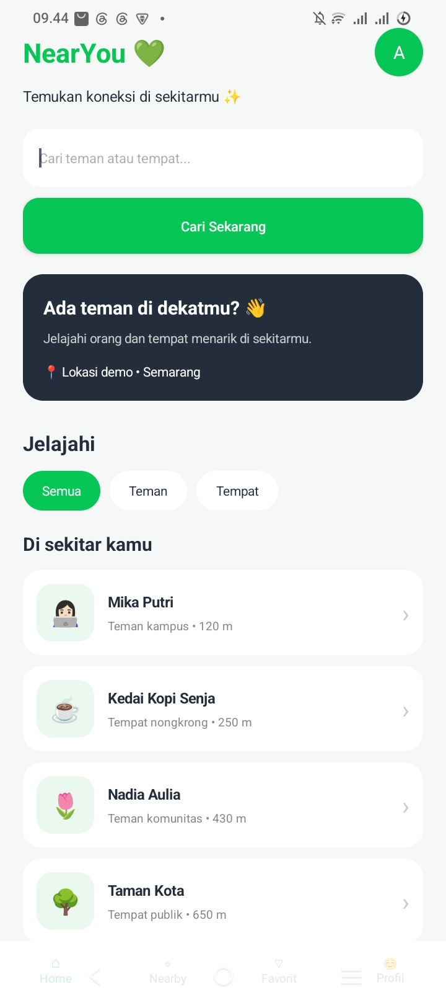
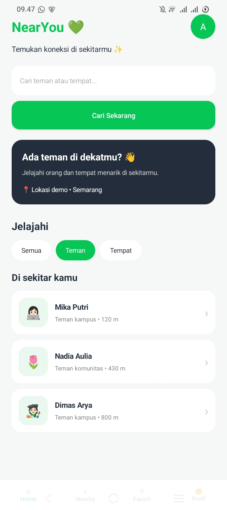
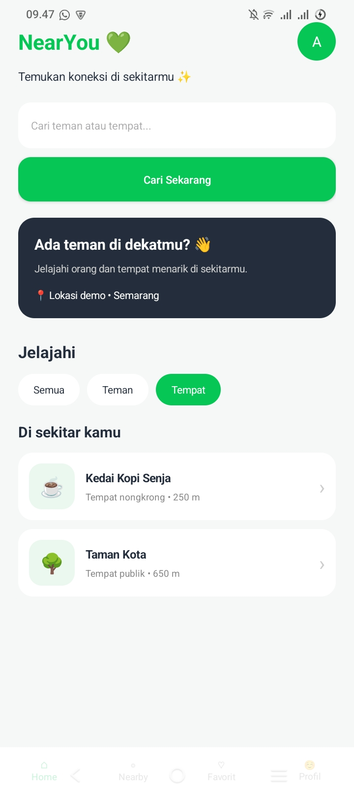
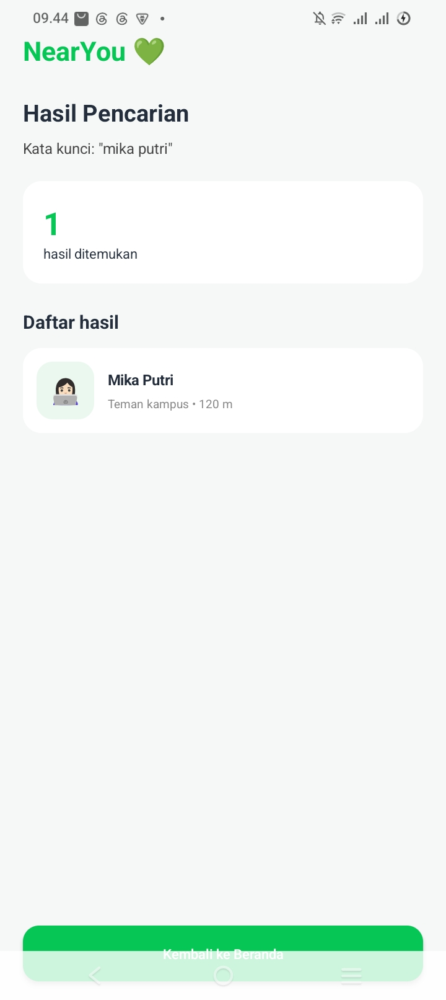

# NearYou 💚

**Tagline:** *Find your people, feel closer.*

NearYou adalah aplikasi Android berbasis Kotlin yang dikembangkan sebagai proyek pembelajaran Pemrograman Mobile. Aplikasi ini terinspirasi dari konsep pencarian teman dan tempat di sekitar pengguna.

## Fitur

- Halaman utama NearYou.
- Pencarian teman atau tempat berdasarkan kata kunci.
- Filter hasil berdasarkan kategori yang tersedia.
- Validasi ketika kolom pencarian kosong.
- Halaman hasil pencarian (`ResultActivity`).
- Pengiriman kata kunci dan data hasil pencarian dari `MainActivity` ke `ResultActivity` menggunakan Android Intent.
- Tombol untuk kembali ke halaman utama.

## Teknologi

- Kotlin
- Android SDK
- Android Studio
- AndroidX AppCompat

## Cara Menjalankan

1. Ekstrak folder proyek.
2. Buka folder `NearYou3` melalui Android Studio.
3. Tunggu proses Gradle Sync selesai.
4. Hubungkan perangkat Android dengan USB debugging aktif, atau pilih emulator.
5. Pilih konfigurasi `app`, lalu tekan **Run**.

## Struktur Utama

```text
NearYou3/
├── app/
│   └── src/
│       └── main/
│           ├── java/com/example/nearyou/
│           │   ├── MainActivity.kt
│           │   └── ResultActivity.kt
│           └── AndroidManifest.xml
├── gradle/
├── build.gradle.kts
├── gradle.properties
├── gradlew
├── gradlew.bat
└── settings.gradle.kts
```

## Catatan

- Hasil pencarian menggunakan data contoh yang tersedia di dalam aplikasi.
- Fitur ini belum menggunakan pelacakan lokasi GPS atau basis data online.
- Screenshot aplikasi dapat ditambahkan ke folder `screenshots/` dan ditautkan di bagian ini.

## Screenshots

### Screen 1 - Home (Semua)


### Screen 2 - Home (Teman)


### Screen 3 - Home (Tempat)


### Screen 4 - Hasil Pencarian


## Demo Aplikasi NearYou
[Klik di sini untuk melihat Demo Aplikasi NearYou](https://drive.google.com/drive/folders/1qvLpvWGRD62TNWtuBqurhI08i1KlaZuU?usp=sharing)
